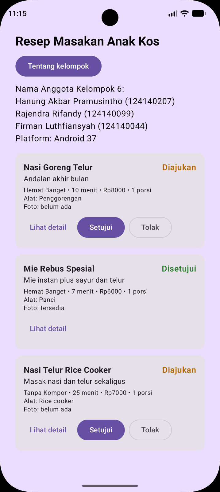

# P2 Model Data, Coroutines, dan Flow

Tema 20: Resep Masakan Anak Kos

## Anggota Kelompok 6

| Nama | NIM | Bagian |
| :- | :- | :- |
| Hanung Akbar Pramusintho | 124140207 | |
| Rajendra Rifandy | 124140099 | |
| Firman Luthfiansyah | 124140044 | |

## Isi

| Berkas | Isi |
| :- | :- |
| `model/Resep.kt` | Entitas utama. `fotoUrl` satu-satunya kolom nullable karena resep boleh belum punya foto |
| `model/KategoriResep.kt` | Entitas pendukung, misalnya Hemat Banget |
| `model/StatusResep.kt` | Sealed class status: Diajukan, Disetujui, Ditolak, beserta fungsi `label()` |
| `data/SumberResep.kt` | Interface `SumberResep` dan `SumberResepPalsu` dengan `delay` dan `MutableStateFlow` |
| `jvmMain/Main.kt` | Program konsol yang mencetak perubahan status |
| `commonTest/SumberResepPalsuTest.kt` | Test perubahan status lewat `ubahStatus` |

## Menjalankan

```bash
./gradlew :app:shared:runConsole
```

## Contoh keluaran konsol

```
Daftar resep:
Nasi Goreng Telur: Diajukan
Mie Rebus Spesial: Disetujui
Nasi Telur Rice Cooker: Diajukan

Admin menyetujui Nasi Goreng Telur...
Daftar resep:
Nasi Goreng Telur: Disetujui
Mie Rebus Spesial: Disetujui
Nasi Telur Rice Cooker: Diajukan
Selesai.
```

## Dokumentasi


