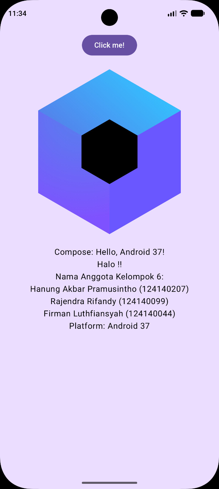

# P3 Dasar Compose Multiplatform

Implementasi lanjutan proyek P2 dengan tema **Resep Masakan Anak Kos**.

## Ketentuan P3

- Layar daftar menggunakan `LazyColumn`.
- Tersedia 10 data contoh dari model data P2.
- Setiap data ditampilkan dalam kartu resep dengan label status dari sealed class `StatusResep`.
- Tersedia pengolahan koleksi: urutan default resep terbaru dan pilihan biaya termurah.
- Tersedia satu FAB tambah data (belum difungsikan sesuai ketentuan).

## Anggota Kelompok 6

- Hanung Akbar Pramusintho (124140207)
- Rajendra Rifandy (124140099)
- Firman Luthfiansyah (124140044)

## Dokumentasi

