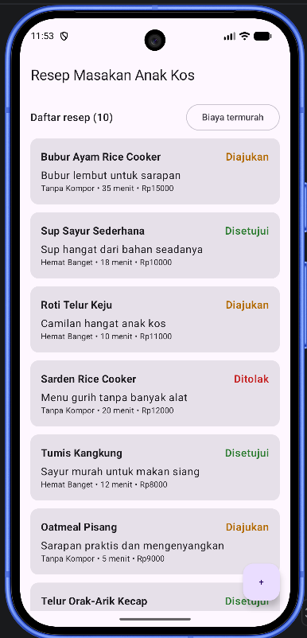

# P3 Dasar Compose Multiplatform

## Identitas Proyek

**Tema:** Resep Masakan Anak Kos  
**Mata Kuliah:** Pengembangan Aplikasi Mobile  
**Pertemuan:** P3 — Dasar Compose Multiplatform  

## Anggota Kelompok 6

| Nama | NIM | Pembagian tugas |
|---|---|---|
| Hanung Akbar Pramusintho | 124140207 |  |
| Rajendra Rifandy | 124140099 |  |
| Firman Luthfiansyah | 124140044 |  |

## Ketentuan Tugas P3

### 1. Layar daftar

Layar utama menampilkan daftar resep menggunakan `LazyColumn`. Setiap resep ditampilkan dalam kartu yang berisi nama, deskripsi, kategori, waktu memasak, estimasi biaya, dan status.

### 2. Kartu entitas dan label status

Kartu resep menggunakan data dari model P2. Status resep berasal dari sealed class `StatusResep` dan ditampilkan sebagai label `Diajukan`, `Disetujui`, atau `Ditolak`.

### 3. Minimal 10 data contoh

Sumber data palsu menyediakan 10 data contoh resep masakan anak kos.

### 4. Olah data sebelum tampil

Daftar resep diolah menggunakan fungsi koleksi Kotlin:

- Urutan awal berdasarkan resep terbaru.
- Tombol **Biaya termurah** untuk mengurutkan resep berdasarkan estimasi biaya.

### 5. Satu aksi utama

Tersedia Floating Action Button (FAB) tambah data. Tombol dibuat sesuai ketentuan tugas dan belum memiliki fungsi tambah data.

## Dokumentasi Aplikasi

File tangkapan layar tersedia di [dokumentasi/dokumentasi.png](dokumentasi/dokumentasi.png).
